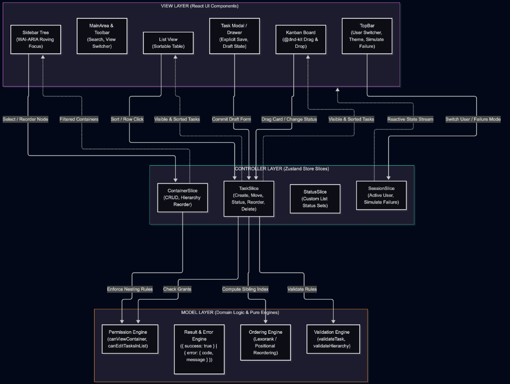
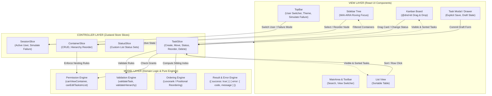

# Flowboard — Project Management Web Application

A modern, high-performance project management web application built with **React**, **TypeScript**, **Vite**, **Zustand**, and **Tailwind CSS**. Flowboard provides an end-to-end task and hierarchy management experience inspired by Linear, Asana, and ClickUp at a focused hobby scale.

---

## Table of Contents

1. [How to Run Locally](#1-how-to-run-locally)
2. [Architecture & System Design (MVC Pattern)](#2-architecture--system-design-mvc-pattern)
3. [Data Model Explanation](#3-data-model-explanation)
4. [Client-Side Permission Enforcement](#4-client-side-permission-enforcement)
5. [Trade-Offs & Week 2 Roadmap](#5-trade-offs--week-2-roadmap)
6. [AI Usage Log & Engineering Judgment](#6-ai-usage-log--engineering-judgment)
7. [DnD Inline Style Exception Documentation](#7-dnd-inline-style-exception-documentation)
8. [Stretch Goals Implemented](#8-stretch-goals-implemented)
9. [Code Quality & Verification Summary](#9-code-quality--verification-summary)

---

## 1. How to Run Locally

### Prerequisites

- **Node.js**: v18.0.0 or higher
- **npm**: v9.0.0 or higher

### Setup Commands

```bash
# 1. Clone repository and navigate to root
git clone <repo-url>
cd flowboard

# 2. Install all dependencies
npm install

# 3. Start local development server (runs at http://localhost:5173)
npm run dev

# 4. Run full test suite (35 test files, 336 tests)
npm test

# 5. Typecheck & Lint validation
npm run typecheck
npm run lint

# 6. Production build & preview
npm run build
npm run preview
```

---

## 2. Architecture & System Design (MVC Pattern)

Flowboard strictly follows the **Model-View-Controller (MVC)** architectural pattern to decouple domain invariants from the user interface:

- **Model (Domain & State)**: Pure domain entities, validation logic, permission resolution engines, and typed selectors (`src/domain/`, `src/store/selectors/`). Contains zero React dependencies.
- **Controller (Zustand Store Actions)**: Central mutation actions (`src/store/slices/`) that enforce permission checks, execute business validations, update the normalized state, and handle rollbacks.
- **View (React UI Layer)**: Accessible, presentation-only components (`src/features/`, `src/components/`) that subscribe to fine-grained selectors and dispatch controller actions.

### Architecture Diagram



<details>
<summary>Click to view Mermaid diagram source code</summary>



</details>

### Project Directory Layout

```text
src/
├── constants/            # Centralized config, storage keys, enums, UI messages, color tokens
├── context/              # Context providers (SidebarProvider, ThemeProvider)
├── domain/               # Pure domain models, validation, permissions, ordering engines
│   └── __tests__/        # Colocated domain unit tests
├── features/             # Feature presentation modules (View layer)
│   ├── kanban/           # Drag-and-drop board, columns, cards, droppables
│   ├── list/             # Sortable table view, rows, headers
│   ├── sidebar/          # Hierarchy tree navigation, roving focus, inline creator
│   ├── task-drawer/      # Accessible task detail/edit modal, draft form
│   ├── toolbar/          # Search bar, view mode switchers, action triggers
│   └── topbar/           # Navigation bar, user switcher, failure simulation toggle
├── hooks/                # Reusable UI hooks (useClickOutside, useKeyboardShortcut)
├── store/                # Zustand controllers, normalized state slices, selectors
│   ├── slices/           # Container, Task, Status, Session controllers
│   ├── selectors/        # Fine-grained derived state selectors
│   └── __tests__/        # Colocated store integration tests
└── types/                # Modular domain, container, task, status, user type definitions
```

---

## 3. Data Model Explanation

Flowboard models a single workspace with a strict 5-level container hierarchy:

```
Workspace (Single Tenant Team)
  └── Space (e.g., "Engineering", "Marketing")
        └── Folder (e.g., "Q2 Launch", "Sprint 42")
              └── List (e.g., "Backlog", "Sprint Board")
                    └── Tasks (Work items inside the list)
```

### Core Entities

1. **Workspace & Containers (`ContainerNode`)**:
   - `id`: Unique string identifier (`ws-1`, `sp-1`, `fol-1`, `lst-1`).
   - `name`: Display name.
   - `type`: Discriminated union `'workspace' | 'space' | 'folder' | 'list'`.
   - `parentId`: ID of the immediate parent container (enforces valid hierarchy nesting: `workspace -> space -> folder -> list`).
   - `position`: Floating-point number for deterministic sibling sorting.
   - `isPrivate`: Boolean flag indicating whether explicit grants are required for non-admin access.

2. **Tasks (`Task`)**:
   - `id`: Unique task ID (`task-101`).
   - `primaryListId`: Foreign key to parent `List`.
   - `title`: Non-empty string (max 500 characters).
   - `description`: Optional plain text or markdown string.
   - `status`: Status key corresponding to one of the list's defined statuses (`todo`, `in_progress`, `done`).
   - `priority`: Tagged priority `'urgent' | 'high' | 'normal' | 'low' | 'none'`.
   - `assigneeIds`: Array of user IDs (`['usr-1', 'usr-2']`).
   - `dueDate`: ISO 8601 string or `null` (restricted from historical past dates).
   - `position`: Position number within status column / list.
   - `createdAt` / `updatedAt`: ISO timestamps.

3. **Status Configuration (`Status`)**:
   - Each list owns its independent status set.
   - Includes `id`, `name`, `category` (`todo` | `in_progress` | `done`), `color`, and `position`.

4. **Grants (`Grant`)**:
   - `{ id, resourceId, userId, mode: 'allow' | 'deny' }`
   - Defines granular access per space, folder, or list.

5. **Users (`User`)**:
   - Pre-seeded with 3 realistic users:
     - **Alice** (`role: 'admin'`): Global workspace administrator; sees and edits all containers and tasks.
     - **Bob** (`role: 'member'`): Sees assigned public containers and explicitly allowed private containers; denied access to restricted lists.
     - **Carol** (`role: 'member'`): Independent member with different access grants.

---

## 4. Client-Side Permission Enforcement

Flowboard guarantees that **permissions are enforced at the data and store level**, not merely visually hidden in the UI:

### Core Rules

1. **Admin Global Bypass**: Users with `role: 'admin'` (Alice) automatically bypass all container access restrictions.
2. **Public Containers**: Visible to all workspace members unless an explicit `deny` grant exists for that user on that resource.
3. **Private Containers**: Completely invisible to members unless an explicit `allow` grant exists for that user on that resource.
4. **Selector-Level Tree Filtering**:
   - `selectVisibleContainers(state)` executes `canViewContainer(container, currentUserId, grants)` for every node.
   - Denied containers and their descendant subtrees are pruned before returning to the UI.
   - Attempting to inspect a denied list URL or ID falls back to an accessible empty view or the first authorized list.
5. **Mutation Security (Store Layer)**:
   - When any mutation action (`createTask`, `updateTask`, `deleteTask`, `changeTaskStatus`) is triggered, the store verifies `canEditTasksInList(targetListId, currentUserId, state)`.
   - Unauthorized attempts immediately reject and return:
     ```typescript
     { error: { code: 'FORBIDDEN', message: 'You do not have permission to modify tasks in this list' } }
     ```
   - Triggers an accessible error toast notification and aborts store modification.

---

## 5. Trade-Offs & Week 2 Roadmap

### What Was Cut for MVP

1. **Flexible Container Nesting**: Lists currently live under Folders (`Space -> Folder -> List`). Direct lists under Spaces were cut to keep domain invariants strict.
2. **Subtasks Depth > 1**: Scoped to single-level tasks to ensure flawless drag-and-drop performance.
3. **Team-Based Role Inheritance**: Scoped to individual user grants rather than nested role groups.
4. **Infinite Scroll Pagination**: Client-side filtering and sorting run over in-memory seeded fixtures (30+ tasks).

### Week 2 Roadmap

- [ ] **Recursive Subtasks**: Nested checklist items with status rollup calculations.
- [ ] **Virtual Scrolling**: Integration of `@tanstack/react-virtual` for lists containing 10,000+ tasks.
- [ ] **Custom Fields Engine**: User-definable custom fields (numeric estimates, tags, dropdowns).
- [ ] **WebSockets Collaboration**: Real-time cursor presence and live updates across multiple concurrent tabs.
- [ ] **Activity & Audit Feed**: Dedicated activity timeline showing task status movement history.

---

## 6. AI Usage Log & Engineering Judgment

Flowboard was developed using modern AI pair programming (Claude 3.7 Sonnet / Antigravity AI) following a strict specification-driven methodology. Complete prompt and override history is documented in [`AI_USAGE.md`](./AI_USAGE.md).

### Key Takeaways

- **Where AI Accelerated**: Rapid scaffolding of TypeScript algebraic types, creation of 336 exhaustive unit/integration tests, and generating the WAI-ARIA roving tabindex keyboard navigation algorithm (`getNextFocusId`).
- **Where Human Judgment Overrode AI**:
  1. _Tailwind v4 Compilation_: Overrode AI's invalid Tailwind v3 `darkMode` config with `@custom-variant dark (&:where(.dark, .dark *));`.
  2. _List View Row Click_: Caught and corrected spec deviation where AI removed row click, restoring mouse row-click to open modal per PDF Page 3.
  3. _Explicit Save Semantics_: Rejected AI's "auto-save on blur" implementation in favor of explicit draft validation and rollback on cancel/Escape.
  4. _Modularity Enforcement_: Refactored AI-generated monolithic components into clean subcomponents strictly $\le 200$ lines.
  5. _Due Date Restriction_: Enforced future-date-only validation for task due dates.

---

## 7. DnD Inline Style Exception Documentation

Per assignment constraints:

> _"No custom CSS files, CSS modules, SCSS, styled-components, Emotion, or inline style= for layout/theming (tiny exceptions for DnD library-required transforms are OK — document them)."_

### Documented Exception:

- **File**: [`src/features/kanban/SortableTaskCard.tsx`](./src/features/kanban/SortableTaskCard.tsx#L46)
- **Code**:
  ```tsx
  const dndTransformStyle = {
    transform: CSS.Translate.toString(transform),
    transition,
  };

  return (
    <div
      ref={setNodeRef}
      style={dndTransformStyle}
      {...(canEdit ? attributes : {})}
      {...(canEdit ? listeners : {})}
      className={isDragging ? 'opacity-40' : undefined}
    >
  ```
- **Rationale**: `@dnd-kit` requires direct matrix/pointer translation applied dynamically to the draggable element's DOM node during pointer dragging. No other inline `style=` attributes exist across the entire application; all layout, theming, spacing, and typography use Tailwind CSS utility classes exclusively.

---

## 8. Stretch Goals Implemented

### 1. Real-Time Client-Side Search

- **Functionality**: Live instant substring search across task titles and descriptions.
- **Affordances**:
  - Focus with keyboard shortcut (`/`).
  - Clear search with clear button or `Escape`.
  - Search-aware empty states across both Kanban and List views with one-click clear triggers.
  - Preserves drag-and-drop and column layout during active search.

### 2. Network Failure Simulation & Rollback Mode

- **Functionality**: TopBar toggle button allowing evaluators to test failure resilience.
- **Affordances**:
  - Simulates HTTP 500 network partition failures on task creation, status movement, reordering, updates, and deletion.
  - Automatically triggers UI rollback and shows descriptive error toast notifications (`"Simulated network failure (HTTP 500)..."`).
  - Proves the system handles unexpected failures gracefully without state corruption.

---

## 9. Code Quality & Verification Summary

- **Test Suite**: 35 test files, 336 tests passing (100% green coverage across domain, store, and UI components).
- **TypeScript**: Strict typechecking with 0 errors (`tsc --noEmit`).
- **ESLint**: 0 warnings, 0 errors.
- **File Discipline**: Every single source file strictly $\le 200$ lines.
